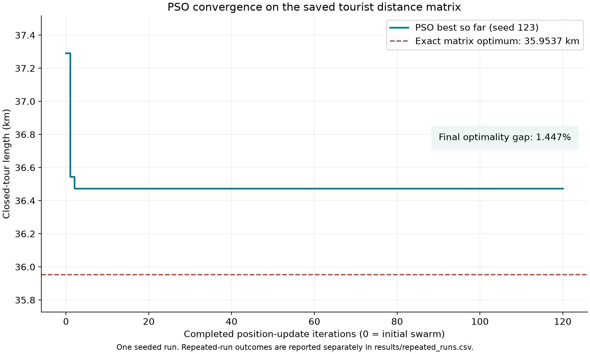

# Optimizing a Cagayan de Oro Tourist Driving Tour Using Particle Swarm Optimization

**Course:** Graph Theory
**Application:** Eight selected tourist destinations within Cagayan de Oro City
**Objective:** Minimize total inter-stop driving distance in a closed tour
**Result:** PSO 36.4739 km; exact matrix optimum 35.9537 km; gap 1.4469%.
**Scope:** Static map-derived car-route costs. This is not a verified daily travel schedule.

## 1. Problem and objective

A group of tourists hires one vehicle to visit eight selected attractions in Cagayan de Oro. The group meets at Plaza Divisoria, visits each of the seven other selected destinations, and returns to the starting point. A driver needs an efficient visiting order that reduces the combined driving distance between stops.

The destinations are selected from the [LakbayPinas travel guide](https://lakbaypinas.com/19-must-visit-cagayan-de-oro-tourist-spots-travel/), published March 7, 2025. This project uses eight CDO destinations from that article, not all places in its title. Selection was fixed before optimization; PSO chooses the order, not which attractions are worth visiting.

The area spans the downtown heritage cluster, the provincial-capitol area, Macasandig, Indahag, and the Malasag/Cugman area. The hilltop stops motivate a driving model. Dahilayan and Divine Mercy Shrine are excluded because they lie outside CDO. Rafting is not represented as a single location without a specified operator/meeting point.

Destinations were identified, mapped, and verified within Cagayan de Oro City using **Google Maps**. Street-level vehicular road distances are computed using the Open Source Routing Machine (OSRM) driving profile to capture real road topologies, turning restrictions, and one-way streets.

### Starting location and required locations

V0 is the modeled meeting/return point on the car network beside Plaza Divisoria. V1–V7 are mandatory stops. Coordinates below are the **routing points**, not automatically the attraction centres or official entrances.

| Node | Tourist destination | Role | Route latitude | Route longitude | Location verification |
|---|---|---|---:|---:|:---:|
| V0 | Plaza Divisoria | Start/finish | 8.4775890 | 124.6437690 | [Google Maps](https://maps.google.com/?q=8.4777014,124.6438021) |
| V1 | Gaston Park | Required tourist stop | 8.4754050 | 124.6425870 | [Google Maps](https://maps.google.com/?q=8.475419,124.6421403) |
| V2 | St. Augustine Metropolitan Cathedral | Required tourist stop | 8.4750860 | 124.6417410 | [Google Maps](https://maps.google.com/?q=8.4748621,124.6414698) |
| V3 | Museo de Oro | Required tourist stop | 8.4760440 | 124.6457730 | [Google Maps](https://maps.google.com/?q=8.4758675,124.6459752) |
| V4 | Vicente de Lara Park | Required tourist stop | 8.4854960 | 124.6476700 | [Google Maps](https://maps.google.com/?q=8.4853122,124.6479715) |
| V5 | High Ridge | Required tourist stop | 8.4623660 | 124.6479350 | [Google Maps](https://maps.google.com/?q=8.462502,124.647814) |
| V6 | Amaya View | Required tourist stop | 8.4230930 | 124.6573050 | [Google Maps](https://maps.google.com/?q=8.4230945,124.6572612) |
| V7 | Gardens of Malasag Eco-Tourism Village | Required tourist stop | 8.4580580 | 124.7000740 | [Google Maps](https://maps.google.com/?q=8.4580377,124.700028) |

The full location table, source-object URLs, attraction coordinates, request coordinates, snapping distances and access assumptions are in `cdo_tsp_locations.csv`. Museo de Oro uses a road point on Corrales Avenue outside the campus. The cathedral uses a point on Gaston Circle. Their mapped road-node evidence is saved. Other sites use nearby points selected by the car-routing service; these are not verified parking spaces.

### Assumptions and constraints

1. One group uses one vehicle; capacity and refuelling do not constrain the visiting order.
2. Start and finish at V0. Schedule one visit to each other stop, with no omitted or duplicate stop.
3. Every inter-stop leg uses the saved OSRM recommended driving route. Costs remain fixed during optimization.
4. Direction matters: the distance from A to B can differ from B to A. The matrix is not symmetrized.
5. The model assumes visitor access can be arranged. It does not enforce opening hours, permits, reservations or time windows, and makes no claim that all activities fit into one day.
6. Parking searches, walking within attractions, sightseeing durations, admission fees, fuel prices and live traffic are outside the distance objective.
7. Connecting roads may repeat or pass near a stop before its scheduled visit. Visiting each destination once does not forbid reusing streets.
8. Access points are map-derived and have not been field-verified. Practical access must be checked before real travel.

### Quantity minimized

Let D[i,j] be the stored length of the recommended car route from stop i to stop j. For a permutation π of all eight nodes with π[0] = 0:

`minimize Z(π) = D[π[0],π[1]] + … + D[π[6],π[7]] + D[π[7],π[0]]`.

Z is reported in kilometres. This optimizes distance, not duration or transportation cost. OSRM chooses its recommended/fastest road route for each pair; its returned distance is not necessarily the shortest possible road distance. Therefore optimality is defined relative to the **stored matrix**, not every possible physical driving path.

## 2. Public data and reproducibility

Attraction identities and coordinates come from OpenStreetMap, corroborated with Google Maps. Pairwise distances and road polylines come from OSRM's public driving service. Raw responses and full request URLs are retained in `data/raw/`, along with UTC retrieval times and SHA-256 hashes. No Google Maps measurements or invented road distances are used for this tourist dataset.

The source acquisition spans **2026-10-14T03:59:57.102255+00:00** to **2026-10-14T04:08:22.881088+00:00**. The Overpass response reports OSM base time **2026-10-14T03:58:17Z**. OSRM graph version: **Not supplied by public server**. These timestamps describe separate services and must not be treated as one identical map build.

The offline builder verifies the raw checksums, eight selected objects, all 64 matrix entries, and all 56 separately requested non-diagonal routes. Route/table lengths agree within 0.00 m. It also checks road-segment sums and geometry endpoints. These are consistency checks, not a ground survey or proof of current site access.

The largest snap from request coordinate to routing point is 49.244 m. The source table retains tenths of metres because that is the provider's output precision; real-world positional/distance accuracy is lower and unmeasured here. Integer decimetres are used internally solely to make tour sums and exact comparisons unambiguous.

See [data/README.md](data/README.md) for access-point decisions, independent location corroboration, limitations and refresh instructions. © OpenStreetMap contributors; OSM-derived geographic and distance data are distributed under ODbL 1.0.

## 3. Methodology and graph model

The TSP is modeled as a complete directed weighted graph G = (V,A,D):
- **Vertices (|V| = 8):** V0 represents the starting and finishing depot (Plaza Divisoria). Vertices V1 through V7 represent mandatory tourist attractions.
- **Edges / Arcs (|A| = 56):** Directed road trips connecting all pairs of distinct stops. Travel is **directed** because one-way streets and divided boulevards cause D[i,j] ≠ D[j,i].
- **Edge weights (D[i,j]):** Directed driving distance in kilometres (derived from OSRM recommended car routes). Self-loop weights D[i,i] = 0.

| From / To (km) | V0 | V1 | V2 | V3 | V4 | V5 | V6 | V7 |
|---|---:|---:|---:|---:|---:|---:|---:|---:|
| V0 | 0.0000 | 0.6335 | 0.7440 | 0.3565 | 1.4477 | 4.4927 | 8.7986 | 9.7055 |
| V1 | 0.3626 | 0.0000 | 0.1327 | 0.5190 | 1.3683 | 4.3810 | 8.6869 | 10.0795 |
| V2 | 0.4957 | 0.1585 | 0.0000 | 0.5562 | 1.5101 | 4.3905 | 8.6964 | 10.2213 |
| V3 | 0.4915 | 0.4734 | 0.5839 | 0.0000 | 1.3014 | 4.3326 | 8.6384 | 9.5591 |
| V4 | 1.2053 | 1.3667 | 1.4995 | 1.2856 | 0.0000 | 5.4261 | 9.7320 | 8.7112 |
| V5 | 4.8874 | 4.6504 | 4.6876 | 4.6020 | 5.7238 | 0.0000 | 7.0242 | 14.0057 |
| V6 | 9.0449 | 8.8079 | 8.8451 | 8.7595 | 9.8813 | 7.3656 | 0.0000 | 13.6527 |
| V7 | 9.9236 | 10.0851 | 10.2178 | 10.0039 | 8.7184 | 13.7256 | 13.5305 | 0.0000 |


*Figure 1: (Left) Labeled weighted topological graph G=(V, A, D) with 8 vertices, 56 directed arcs, and the PSO tour highlighted in teal. (Right) Asymmetric travel-cost matrix D showing OSRM recommended driving-route lengths in km.*

## 4. Assigned algorithm: Particle Swarm Optimization (Section 2.4)

In the assigned reference (*Luna-Garcia, Candano, & Caga-anan, 2024, Section 2.4, Algorithm 2.4*), Particle Swarm Optimization (PSO) is adapted to solve the Traveling Salesperson Problem. Because classical PSO operates on continuous real-number vectors, applying PSO to the TSP requires representing candidate solutions as discrete city permutations, often termed Discrete PSO.

Here, each particle represents a candidate visiting order beginning and ending at the depot V0. Its personal best ($pbest$) is the lowest-cost tour it has visited so far, and the global best ($gbest$) is the lowest-cost tour found by any particle in the entire swarm. Velocity is represented as a sequence of transpositions (swaps) between non-depot city positions, preserving the permutation constraint without duplicating or omitting any destination.

### Update procedure

1. Initialize 40 random depot-fixed permutations, evaluate them, and save personal/global bests. Record this as iteration 0.
2. For each update, freeze a copy of the global best as the shared target for that generation.
3. Independently retain and apply each swap from the previous velocity with probability w = 0.5.
4. Scan non-depot positions toward the personal best. When a position differs, accept an aligning swap with probability c1 = 0.8. Update the working permutation and its city-to-index map immediately.
5. Repeat sequential alignment toward the frozen global best with probability c2 = 0.8.
6. With probability 0.2, apply one random swap of two non-depot positions for exploration. Retain at most the latest 2n actual swaps as the next velocity.
7. Evaluate the updated position and improve personal best if its cost decreased. After all particles, update the global best and record its cost.
8. Stop after 120 updates and return the best observed tour. There is no early stopping or exact-solver information injected into PSO.

c1 and c2 are probabilities in [0,1], not continuous-PSO acceleration constants. Invalid values such as 1.5 are rejected. Computing and applying alignment swaps sequentially avoids stale-index cancellation. A local random generator makes seeds repeatable without changing Python's global random state. Every final updated population is evaluated.

### Key steps and calculation walkthrough

To demonstrate how discrete PSO operates on our tourist graph, consider a concrete numerical calculation:

1. **Permutation representation and tour cost:**
   A candidate solution (particle) is represented as a permutation $\pi$ of stops with fixed depot $\pi[0] = 0$:
   $$\pi = [0, \pi[1], \pi[2], \pi[3], \pi[4], \pi[5], \pi[6], \pi[7]]$$
   The closed-tour distance is calculated as:
   $$Z(\pi) = \sum_{k=0}^{7} D[\pi[k],\, \pi[(k+1) \bmod 8]]$$

2. **Current particle state:**
   Suppose particle $k$ has current visiting order:
   $$X = [V_0, V_3, V_1, V_2, V_4, V_5, V_6, V_7]$$
   Looking up each directed leg from the weight matrix:
   - $D[V_0, V_3] = 0.3565\text{ km}$
   - $D[V_3, V_1] = 0.4734\text{ km}$
   - $D[V_1, V_2] = 0.1327\text{ km}$
   - $D[V_2, V_4] = 1.5101\text{ km}$
   - $D[V_4, V_5] = 5.4261\text{ km}$
   - $D[V_5, V_6] = 7.0242\text{ km}$
   - $D[V_6, V_7] = 13.6527\text{ km}$
   - $D[V_7, V_0] = 9.9236\text{ km}$ (return to depot)
   $$\text{Total Cost } Z(X) = 0.3565 + 0.4734 + 0.1327 + 1.5101 + 5.4261 + 7.0242 + 13.6527 + 9.9236 = \mathbf{38.4993\text{ km}}$$

3. **Alignment swap calculation:**
   Suppose the global best target is:
   $$T = [V_0, V_3, V_4, V_7, V_6, V_5, V_2, V_1]$$
   During social attraction toward $T$ with parameter $c_2 = 0.8$:
   - At index $i=1$: $X[1] = V_3$ matches $T[1] = V_3$.
   - At index $i=2$: $X[2] = V_1 \neq T[2] = V_4$. The target node $V_4$ currently resides at index 4 in $X$.
   - A uniform random draw $r \in [0, 1)$ is evaluated. Since $r < 0.8$, the swap $(2, 4)$ is accepted.
   - Swapping positions 2 and 4 yields the updated order:
     $$X' = [V_0, V_3, V_4, V_2, V_1, V_5, V_6, V_7]$$

4. **Recalculating updated tour distance:**
   The swap alters the edges incident to positions 2 and 4. Summing the new legs:
   - $D[V_0, V_3] = 0.3565\text{ km}$
   - $D[V_3, V_4] = 1.3014\text{ km}$ (replaces $V_3 \to V_1$)
   - $D[V_4, V_2] = 1.4995\text{ km}$ (replaces $V_1 \to V_2$)
   - $D[V_2, V_1] = 0.1585\text{ km}$ (replaces $V_2 \to V_4$)
   - $D[V_1, V_5] = 4.3810\text{ km}$ (replaces $V_4 \to V_5$)
   - $D[V_5, V_6] = 7.0242\text{ km}$
   - $D[V_6, V_7] = 13.6527\text{ km}$
   - $D[V_7, V_0] = 9.9236\text{ km}$
   $$\text{Updated Cost } Z(X') = \mathbf{38.2974\text{ km}}$$
   Because $Z(X') = 38.2974\text{ km} < 38.4993\text{ km}$, the particle updates its personal best ($pbest$), retaining the improvement.

### Complexity and limitations

For n locations, P particles and T updates, the bounded velocity and maintained index map give expected **O(Pn + TPn)** time and **O(Pn)** swarm memory, in addition to the O(n²) input matrix. If P and T are both chosen proportional to n, this implementation's expected time becomes O(n³). That is a conditional scaling statement, not a universal PSO bound or a proof of fast exact optimization.

PSO has no general optimality guarantee and may stagnate. The exact solver checks (n−1)! orders and computes n edges per order: O(n × (n−1)!) time. For this eight-node problem that is 5,040 tours. The PSO demonstration evaluates 40 × 121 = 4,840 candidates, including possible repeats. This small example does not establish a speed or scalability advantage.

## 5. Implementation, verification, and results

Per the project instructions, the focus is the assigned algorithm (Discrete PSO); comparative algorithm studies are not required. Exhaustive brute-force evaluation ($5,040$ depot-fixed permutations) was implemented strictly as a mathematical verification benchmark to test whether PSO reaches a proven global optimum. Nearest neighbor is listed only as an optional baseline.

| Method | Role in Project | Tour length (km) | Evidence / Purpose |
|---|---|---:|---|
| **Discrete PSO (Seed 123)** | **Assigned Algorithm** | **36.4739** | 40 particles, 120 updates; 1.4469% optimality gap |
| Brute force | Verification Benchmark | 35.9537 | All 5,040 depot-fixed orders evaluated (proof of global optimum) |
| Nearest neighbor | Optional Baseline | 38.4993 | Deterministic greedy heuristic from V0 |

The seeded PSO tour **is an approximate solution for the stored matrix**. Its gap is **1.4469%**, or **520.2 metres** above the exact result. This demonstration run did not reach the exact optimum within 120 updates. Initial swarm best: **37.2907 km**.

- PSO order: **V0 → V3 → V4 → V7 → V6 → V5 → V2 → V1 → V0**.
- Exact benchmark order: **V0 → V3 → V1 → V2 → V5 → V6 → V7 → V4 → V0**.
- Seeded PSO compute time: 0.032619 s.
- Brute-force compute time: 0.009788 s.

Times are one local run under Python 3.13.13; they exclude downloads, plots and repeated-seed experiments and will vary by machine/run. Raw outcomes and input hashes are recorded in `results/summary.json`.

### Repeated seeds

Across seeds 0–29, **4 of 30** runs matched the exact matrix optimum. Mean distance: **36.6298 km**; range: **35.9537–38.4476 km**. All runs use the same parameters and matrix. This measures seed variation for one selected instance, not performance across cities or larger graphs. The demonstration seed 123 is separate from these 30 runs.



## 6. Closed-tour verification

| Leg | From | To | Distance (km) |
|---|---|---|---:|
| 1 | V0 | V3 | 0.3565 |
| 2 | V3 | V4 | 1.3014 |
| 3 | V4 | V7 | 8.7112 |
| 4 | V7 | V6 | 13.5305 |
| 5 | V6 | V5 | 7.3656 |
| 6 | V5 | V2 | 4.6876 |
| 7 | V2 | V1 | 0.1585 |
| 8 | V1 | V0 | 0.3626 |
| Total | | | **36.4739** |

The implementation checks that every node occurs exactly once, V0 is first, and the implicit final leg returns to V0. The audited leg sum equals the reported PSO cost. Reversing the order is not assumed equivalent because the input is asymmetric.


The road plot uses the saved geometry for each actual directed leg. It does not draw straight-line edges and label them as road routes. Its title uses the PSO cost and a conditional optimality statement. The route order can be used to discuss tourist-stop sequencing; it does not establish parking legality, entrance access or a feasible schedule of visits.

## 7. Verification and reproducible commands

```bash
python3 -m pip install -r requirements.txt
python3 scripts/build_dataset.py
python3 cdo_tsp_pso_solver.py
python3 scripts/update_documents.py
python3 -m unittest discover -s tests -v
```

Source-to-CSV reconstruction must reproduce identical files. Tests also cover directed return-leg costs, independent exact enumeration, valid sequential swaps, final-update evaluation, valid tours, reproducible seeds, invalid parameters, missing/duplicate CSV pairs, and loaded CSV changes. The notebook performs a temporary data rebuild before executing the shared experiment.

The original delivery dataset, solver, report, notebook and images remain in `archive/delivery-example-c44f835.zip`. They describe a separate historical scenario and are not evidence for these tourist results.

## 8. References

1. LakbayPinas (2025). [19 Must-Visit Cagayan de Oro Tourist Spots](https://lakbaypinas.com/19-must-visit-cagayan-de-oro-tourist-spots-travel/). Destination-selection source only.
2. [OpenStreetMap contributors](https://www.openstreetmap.org/copyright). Public geographic database; exact object references in the locations CSV.
3. [OSRM API documentation](https://project-osrm.org/docs/v5.24.0/api/). Driving table and route semantics; raw responses retained locally.
4. Luna-Garcia, R., Candano, T. M. C., and Caga-anan, R. L. (2024). [Performance Analysis of Classical Algorithms for the Traveling Salesman Problem](https://doi.org/10.62071/tmjm.v6i2.716). The Mindanawan Journal of Mathematics, 6(2), 79–111. Assigned PSO reference; implementation adaptations are stated in Section 4.
