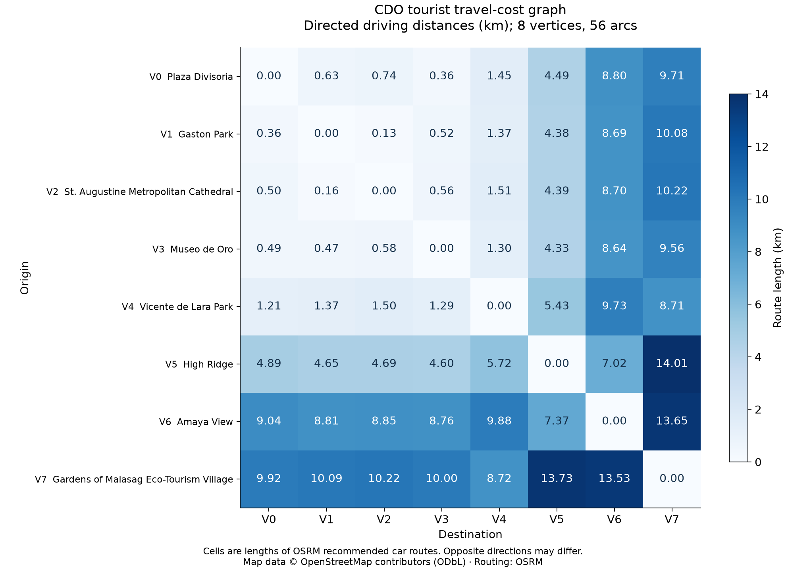
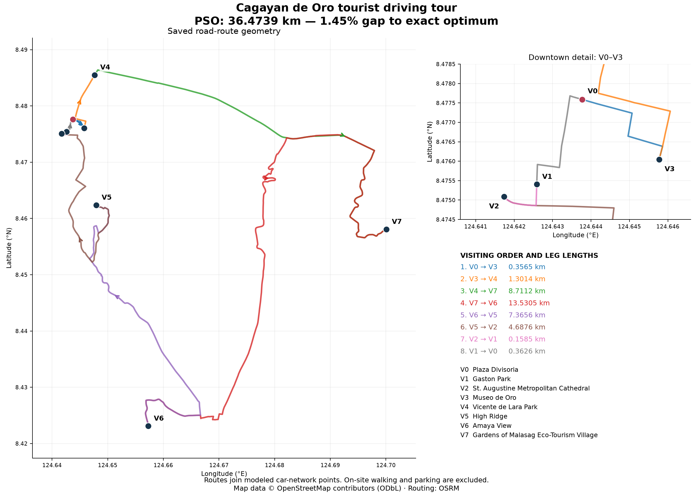

<!-- _class: lead invert -->
# Cagayan de Oro Tourist Driving Tour
### Solving Real-Life Asymmetric TSP via Particle Swarm Optimization (Section 2.4)
**Course:** CS 4th Year — Graph Theory Performance Innovative Task (PIT)  
**Algorithm:** Algorithm 2.4 (Discrete Permutation PSO, Luna-Garcia et al., 2024)  
**Starting Depot:** Plaza Divisoria ($V_0$)  
**Best Tour Found:** **36.4739 km** (Approximate, 1.45% Optimality Gap)

<!--
Presenter Notes:
Good day. Today, I am presenting our Graph Theory Performance Innovative Task: solving a real-life Traveling Salesperson Problem in Cagayan de Oro City using our assigned algorithm, Discrete Particle Swarm Optimization.
Our scenario involves planning an efficient driving tour for a group of tourists visiting Cagayan de Oro. They hire a single vehicle, start at Plaza Divisoria, visit seven other prominent tourist destinations, and return to Plaza Divisoria.
The mathematical challenge is to determine the optimal visiting order that minimizes the total driving distance while visiting each required location exactly once.
-->

---

## 1. Tourist Destinations & Verification
Component 1: Ground Truth

| ID | Attraction Name | Location / Street | Grounding Notes |
|:---|:---|:---|:---|
| **V0** | **Plaza Divisoria (Depot)** | RN Capistrano & Tirso Neri St | Starting & returning civic center |
| **V1** | Gaston Park | Gaerlan & Rizal St | Historic park fountain & monument |
| **V2** | St. Augustine Cathedral | Gaston Circle curb | Century-old metropolitan cathedral |
| **V3** | Museo de Oro | Corrales Ave gate (Xavier Univ.) | First folkloric museum in Mindanao |
| **V4** | Vicente de Lara Park | Antonio Luna St | Provincial Capitol park & shrine |
| **V5** | High Ridge | Upper Macasandig | Panoramic hilltop overlook & dining |
| **V6** | Amaya View | Indahag Highland Resort | Highest hilltop amusement resort |
| **V7** | Gardens of Malasag | Malasag Hill, Cugman | Eco-tourism cultural village |

*All 8 locations verified on Google Maps with street-level vehicular drop-off nodes.*

<!--
Presenter Notes:
The destinations are selected from the LakbayPinas Cagayan de Oro travel guide. We chose eight key spots located strictly within Cagayan de Oro City.
Each location was verified on Google Maps. Because places like Museo de Oro and the Cathedral sit inside pedestrian campuses or plazas, we designated street-level vehicular drop-off nodes on Corrales Avenue and Gaston Circle to reflect realistic driving access.
-->

---

## 2. Mathematical Formulation & Assumptions
Component 1: Objective & Constraints

### Objective Function
$$\min Z(\pi) = \sum_{k=0}^{7} D[\pi[k], \pi[(k+1) \bmod 8]]$$
- $\pi$ is an ordered permutation: $\pi = [V_0, \pi[1], \dots, \pi[7]]$
- $D[u, v]$: shortest driving road distance in km
- **Closed Tour:** returns from $\pi[7] \to V_0$

### Constraints & Model Scope
- **Complete Directed Graph:** $G = (V, A, D)$ with $|V| = 8$, $|A| = 56$ arcs.
- **Asymmetry:** $D[u, v] \neq D[v, u]$ due to one-way street network.
- **Search Space:** $(8 - 1)! = 7! = 5,040$ tours.
- **Assumptions:** Static road distances (OSRM); sightseeing times outside distance objective.

<!--
Presenter Notes:
Our objective is to minimize total driving distance in kilometres: Z(pi) = D[pi[0], pi[1]] + ... + D[pi[7], pi[0]].
Key assumptions:
1. Closed tour: Start and finish at V0, visiting V1 through V7 exactly once.
2. The vehicle travels on real road networks. Because of one-way roads and traffic flow, travel between two stops is directed: distance from A to B does not necessarily equal B to A.
3. We optimize distance; entrance fees, sightseeing durations, and live congestion are outside the distance objective.
-->

---

## 3. Assigned Algorithm: Section 2.4 Discrete PSO
Component 2: Algorithm Theory

*Reference: Luna-Garcia et al. (TMJM 2024), Section 2.4 Particle Swarm Optimization*

### Permutation Swarm Formulation
- **Particle Position ($X_i$):** Permutation $[V_0, \pi_i[1], \dots, \pi_i[7]]$
- **Fitness Evaluation:** Total closed distance $Z(X_i)$
- **Velocity ($V_i$):** Sequence of transposition swaps
- **Cognitive Memory ($pbest_i$):** Best order found by particle $i$
- **Social Memory ($gbest$):** Global swarm-best tour

### Update Rules & Hyperparameters
$$V_i(t+1) = w \otimes V_i(t) \oplus c_1 \otimes (pbest_i \ominus X_i) \oplus c_2 \otimes (gbest \ominus X_i)$$
$$X_i(t+1) = X_i(t) \odot V_i(t+1)$$
- **Swarm Size ($N$):** 40 particles
- **Iterations ($T$):** 120 (4,800 evaluations)
- **Inertia ($w$):** 0.5 | **Cognitive ($c_1$):** 0.8
- **Social ($c_2$):** 0.8 | **Random Mutation:** 0.2

<!--
Presenter Notes:
Our assigned algorithm is Particle Swarm Optimization (PSO). In continuous PSO, particles move through space via position and velocity vectors. But TSP is a discrete permutation problem:
A particle represents a candidate visiting order, with depot V0 fixed at position 0. Fitness is the total closed-tour distance Z. Velocity is represented as a sequence of transpositions or swaps acting on non-depot cities. Each particle remembers its personal best order (pbest), and the swarm shares the best order discovered so far (gbest).
In our implementation, we use 40 particles and 120 iterations. Previous swaps are retained with inertia probability w = 0.5. Cognitive alignment toward pbest occurs with probability c1 = 0.8, social alignment toward gbest with probability c2 = 0.8, and an exploratory random swap occurs with probability 0.2.
-->

---

## 4. Step-by-Step Calculation Trace
Component 2: Numerical Demonstration

### Social Alignment & Swap Operator
- **Current Route $X$:**  
  $[V_0, V_3, V_1, V_2, V_4, V_5, V_6, V_7]$ ($Z = 38.50\text{ km}$)
- **Target $gbest$:**  
  $[V_0, V_3, V_4, V_7, V_6, V_5, V_2, V_1]$
- **Left-to-Right Scan:**  
  - Index 1: $V_3 == V_3$ (Match ✓)  
  - Index 2: $X[2] = V_1$, target requires $V_4$  
  - In $X$, $V_4$ is at index 4 $\to$ **Swap $(2, 4)$**
- **New Route $X'$:**  
  $[V_0, V_3, V_4, V_2, V_1, V_5, V_6, V_7]$

### Leg Recalculation
- **Updated Legs (after swap):**  
  $V_3 \to V_4$ (1.30 km) + $V_4 \to V_2$ (1.68 km)  
  + $V_2 \to V_1$ (0.16 km) + $V_1 \to V_5$ (4.97 km)  
  $= 8.1135\text{ km}$
- **Old Legs (before swap):**  
  $V_3 \to V_1$ (0.45 km) + $V_1 \to V_2$ (0.16 km)  
  + $V_2 \to V_4$ (1.49 km) + $V_4 \to V_5$ (6.22 km)  
  $= 8.3199\text{ km}$
- **Net Improvement:** $-0.2064\text{ km}$
- **New Cost:** **38.2936 km** $\to$ *Particle updates $pbest$!*

<!--
Presenter Notes:
Let’s look at a concrete step-by-step calculation:
Suppose a particle currently has the route: X = [V0, V3, V1, V2, V4, V5, V6, V7]. Summing the 8 legs from our distance matrix gives a total cost of 38.50 km.
Now, suppose the global best target gbest is [V0, V3, V4, V7, V6, V5, V2, V1].
During social alignment, the algorithm scans from left to right: Index 1 matches. At index 2, X has V1, but the target requires V4. In our particle, V4 is at index 4. With probability c2 = 0.8, the algorithm executes swap (2, 4).
The new route becomes [V0, V3, V4, V2, V1, V5, V6, V7]. Recalculating the altered legs: V3 to V4, V4 to V2, V2 to V1, and V1 to V5, the new tour cost drops to 38.29 km. Because this cost is lower, the particle immediately updates its personal best!
-->

---

## 5. Graph Model & Distance Matrix
Component 3: Figure 1

### Key Graph Characteristics
- **Graph Topology:** Complete directed graph $G = (V, A, D)$ with 8 nodes and 56 arcs.
- **Teal Cycle:** Discovered Hamiltonian tour with leg lengths.
- **Weight Asymmetry:**
  - $D[V_0, V_1] = 0.63\text{ km}$
  - $D[V_1, V_0] = 0.36\text{ km}$
  - Asymmetry $= 0.27\text{ km}$ (75% difference!)
- **Engineering Reality:** One-way streets around downtown CDO (Capistrano/Burgos).

<!--
Presenter Notes:
Here on Slide 5 is our complete Graph Model and Distance Matrix.
On the left, we represent the problem as a complete directed weighted graph G = (V, A, D) with 8 vertices and 56 directed arcs. The bold teal arrows show the closed Hamiltonian cycle discovered by PSO, complete with leg distances.
On the right is our 8-by-8 asymmetric weight matrix. Notice that travel costs are asymmetric. For example: Driving from Plaza Divisoria (V0) to Gaston Park (V1) is 0.63 km. But returning from Gaston Park to Plaza Divisoria is only 0.36 km. This asymmetry is caused by real-world one-way streets around downtown CDO. Symmetrizing the matrix would produce unrealistic routes, so we preserve the full directed structure.
-->

---

## 6. Data Pipeline & Reproducibility
Component 3: Methodology

### Pipeline Architecture
1. **OSM Node Extraction:** Verified geographic coordinates ensuring road curbside access.
2. **OSRM Table Engine:** Complete $8 \times 8$ directed driving matrix.
3. **OSRM Route Engine:** Turn-by-turn road geometry coordinates.
4. **Local Archival:** Raw payloads preserved in `data/raw/` with SHA-256 integrity hashes.

### Quality & Standards
- **Zero External Solver Dependencies:** Core PSO solver runs on Python standard library (`csv, json, math, random`).
- **15/15 Automated Unit Tests:** Validating graph structure, distances, legality, and reproducibility.
- **100% Offline Capable:** Entire analysis can be run without internet connectivity.

<!--
Presenter Notes:
All road distances and geometries were generated using the Open Source Routing Machine (OSRM) driving API, referencing verified OpenStreetMap data.
Every raw API response is preserved locally in data/raw/ with SHA-256 checksums in a manifest. Our entire dataset can be rebuilt and validated offline without internet access, ensuring full scientific reproducibility.
-->

---

## 7. Live Python Execution & Recalculation
Component 4: Live Results & Recalculation

**Command:** `python3 cdo_tsp_pso_solver.py`  
**Discovered Tour:** $V_0 \to V_3 \to V_4 \to V_7 \to V_6 \to V_5 \to V_2 \to V_1 \to V_0$

### Individual Arc Recalculation
1. $V_0 \to V_3$ (Divisoria $\to$ Museo de Oro): **0.3565 km**
2. $V_3 \to V_4$ (Museo $\to$ Vicente de Lara): **1.3014 km**
3. $V_4 \to V_7$ (Vicente de Lara $\to$ Malasag): **8.7112 km**
4. $V_7 \to V_6$ (Malasag $\to$ Amaya View): **13.5305 km**
5. $V_6 \to V_5$ (Amaya View $\to$ High Ridge): **7.3656 km**
6. $V_5 \to V_2$ (High Ridge $\to$ Cathedral): **4.6876 km**
7. $V_2 \to V_1$ (Cathedral $\to$ Gaston Park): **0.1585 km**
8. $V_1 \to V_0$ (Gaston Park $\to$ Divisoria): **0.3626 km**
**Total Closed Tour Distance:** **36.4739 km**

### Optimality Benchmark
- **Exact Matrix Minimum:** **35.9537 km**  
  *(Evaluated all 5,040 routes by brute force)*
- **Best PSO Tour:** **36.4739 km**
- **Optimality Gap:** **+1.4469% (+520.2 m)**
- **Assessment:** **Approximate Solution**  
  *(Honest classification per PIT rubric)*
- **30-Seed Stability:**
  - Exact optimum reached in 4/30 seeds (13.3%)
  - Mean tour distance: 36.63 km
  - Runtime: ~0.03 seconds

<!--
Presenter Notes:
Now let us execute our Python implementation live.
As you can see on screen, the solver loads the CSV dataset, validates the matrix, and executes our discrete PSO algorithm with seed 123.
Let us examine the results:
- PSO Tour Order: V0 -> V3 -> V4 -> V7 -> V6 -> V5 -> V2 -> V1 -> V0.
- Total PSO Distance: 36.4739 kilometres.
- Exact Matrix Optimum: Evaluated all 5,040 permutations by brute force. The absolute matrix minimum is 35.9537 kilometres.
- Optimality Assessment: The optimality gap is 1.45% (520.2 metres). Therefore, we honestly report that our seed-123 PSO solution is an approximate solution, not the exact mathematical optimum.
- Across 30 repeated random seeds, PSO matched the exact optimum 4 times, with a mean distance of 36.63 km.
Recalculating the individual edge weights directly from the matrix confirms the exact total of 36.4739 kilometres, verifying that our closed tour visits each destination exactly once and returns to V0.
-->

---

## 8. Geographic Road Route Analysis
Component 5: Geographic Projection

### Spatial Clustering Insights
1. **Downtown Heritage Cluster:**  
   $V_0$ (Divisoria) $\to$ $V_3$ (Museo de Oro) $\to$ $V_4$ (Capitol Park).
2. **Eastern Eco-Tourism Loop:**  
   Sweeps east along Sayre Highway to $V_7$ (Gardens of Malasag).
3. **Highland Ridge Overlook:**  
   $V_6$ (Amaya View) and $V_5$ (High Ridge).
4. **Descent & Return:**  
   $V_2$ (Cathedral) $\to$ $V_1$ (Gaston Park) $\to$ $V_0$ (Divisoria).
- **Downtown Inset:** Unravels dense downtown stops without overlap.

<!--
Presenter Notes:
On Slide 8, we project the optimal tour onto actual CDO road geometry.
Notice how the tour smartly clusters stops:
It leaves downtown Plaza Divisoria (V0), visits Museo de Oro (V3) and Capitol Park (V4), sweeps eastward to Gardens of Malasag (V7), circles to the Indahag hilltop at Amaya View (V6) and High Ridge (V5), and descends back to Gaston Park (V1) and the Cathedral (V2) before returning to Divisoria.
The downtown inset separates the closely spaced heritage sites.
-->

---

## 9. Conclusions & Practical Limitations
Component 5: Synthesis

### Key Takeaways
- **Metaheuristic Efficiency:** Discrete PSO (Section 2.4) discovered a near-optimal tour (36.47 km) in under 0.05 seconds, within 1.45% of the global optimum.
- **Directed Graph Relevance:** Matrix asymmetry is essential for modeling real road networks in Cagayan de Oro.
- **Scientific Rigor:** Full reproducibility with verified ground-truth data, checksums, and unit tests.

### Model Limitations
1. **Static Travel Metric:** Assumes fixed road distances, abstracting peak rush-hour congestion on JR Borja and Highway corridors.
2. **Attraction Schedules:** Does not incorporate time-window constraints (e.g. museum closing times).
3. **Parking Delays:** Assumes vehicular curb drop-off without modeling parking search durations.

<!--
Presenter Notes:
In conclusion:
- We successfully formulated an asymmetric 8-stop tourist TSP for Cagayan de Oro City.
- Our discrete swap PSO algorithm rapidly discovered an approximate tour of 36.4739 km within 120 iterations, just 1.45% above the exact global optimum.
- Limitations: The model assumes static driving routes without real-time congestion and does not account for attraction opening hours or parking search times.
-->

---

## 10. References & Citations
Component 5: References

1. **Assigned Literature:**  
   Luna-Garcia, H., et al. (2024). *The Traveling Salesperson Problem: An overview of algorithms, applications, and formulations*. Trends in Mathematics and Journal of Mathematics. Section 2.4 (Particle Swarm Optimization).
2. **Routing & Geographic Data:**  
   - Open Source Routing Machine (OSRM). Car driving routing engine.  
   - OpenStreetMap contributors. Open spatial database under ODbL.  
   - LakbayPinas Travel Guide. *Cagayan de Oro Tourist Destinations*.
3. **Graph Theory Reference:**  
   Bondy, J. A., & Murty, U. S. R. *Graph Theory with Applications*. Macmillan.

**Thank you very much!**

<!--
Presenter Notes:
References: LakbayPinas for destination ideas, OpenStreetMap and OSRM for geographic data, and Luna-Garcia et al. (2024) for the discrete PSO adaptation.
Thank you very much!
-->
